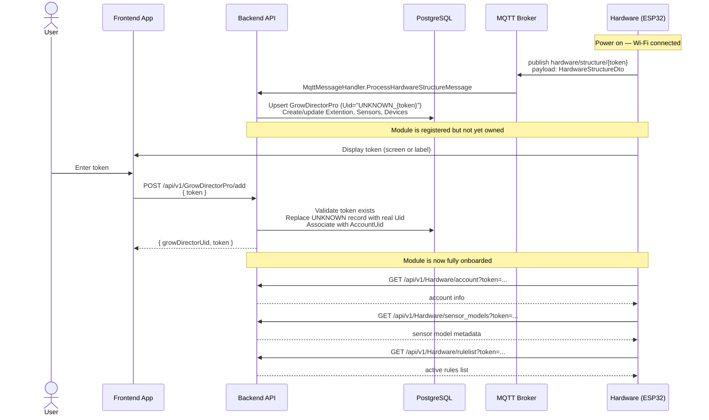

# Module Initialization & Onboarding

> Part of: [Hardware ↔ Backend Architecture](./README.md)

---

## Overview

Module initialization is a **two-phase process**:

1. **Hardware first-boot** — the module powers on, connects to Wi-Fi, and pushes its structure (sensors, devices) to the backend using its pre-flashed token.
2. **User pairing** — the user opens the app, enters the token shown on the module (or scans it), and associates the module with their account.

Until Step 2 is complete, the module is registered in the backend as a temporary `UNKNOWN_<token>` record and cannot be managed by the user.

---

## Concepts

| Term | Meaning |
|------|---------|
| **GrowDirectorPro** | Backend record for a registered module. Has `Uid` (MAC), `Token`, `AccountUid`. |
| **Token** | Unique string pre-flashed or generated on first boot. Authenticates all hardware→backend communication. |
| **Extention** | Physical board represented in the backend. One GrowDirectorPro has one or more Extentions. |
| **Structure** | The full hardware description: connected sensors, devices (relays, sockets, pumps, dimmers), pin assignments. |

---

## Sequence



---

## Hardware → Backend: Structure Payload

**MQTT topic:** `hardware/structure/{growDirectorUid}`
**HTTP alternative:** `POST /api/v1/Hardware/structure`

**`HardwareStructureDto`** — top-level fields:

| Field | Type | Description |
|-------|------|-------------|
| `GrowdirectorUid` | string | Module MAC / hardware identifier |
| `Token` | string | Auth token |
| `Timestamp` | DateTime | When structure was captured |
| `Nodes` | array | Physical boards, each with sensors and devices |

Each node describes its connected hardware: sensor UIDs and types, relay/socket/pump/dimmer pin assignments.

**Backend processing** (`HardwareApplicationService.SaveHardwareStructureAsync`):
1. Validate token → resolve `GrowDirectorPro`
2. Create or update `Extention` records
3. Upsert `Sensor` and `Device` records from the node list
4. Mark module as Online (`ModuleActivityHistory`)

---

## Backend → Frontend: Token Generation

Before hardware arrives, the app can pre-generate a token:

```
GET /api/v1/GrowDirectorPro/generate_token
```

Returns a token that can be pre-configured in firmware (or pre-printed on the device label).

---

## Factory Reset

When a module is factory-reset and re-flashed:
- It re-sends its structure with the **same token**
- The backend **re-associates** existing sensor and device records (not deleted, Uid stays the same)
- Historical data (sensor history, device history) is **preserved**
- The user does not need to re-pair — the token is unchanged

---

## Key Files

| File | Role |
|------|------|
| `GrowDirectorWebApi/Controllers/GrowDirectorProController.cs` | `add` and `generate_token` endpoints |
| `GrowDirector.Application/Services/GrowDirectorProServices/GrowDirectorProService.cs` | `AddGrowDirectorProForAccountWithTokenAsync` — pairing logic |
| `GrowDirector.Application/Services/HardwareServices/HardwareApplicationService.cs` | `SaveHardwareStructureAsync` — structure processing |
| `GrowDirector.Application/Dto/Hardware/HardwareStructureDto.cs` | Structure payload DTO |
| `GrowDirector.Application/Services/MqttServices/MqttMessageHandler.cs` | `ProcessHardwareStructureMessage` — MQTT entry point |
