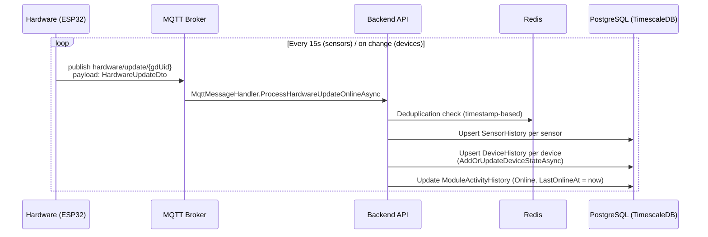

# Periodic Hardware Updates & Connectivity

> Part of: [Hardware ↔ Backend Architecture](./README.md)

---

## Overview

The module continuously streams its state to the backend. This single `hardware/update` message is the **primary data pipeline** — it carries sensor readings, device states, and the context of which rule or command caused each state change.

---

## Update Frequency

| Data type | Interval | Mechanism |
|-----------|----------|-----------|
| Sensor values | Every **15 seconds** | Timer-based (`SENSOR_UPDATE_INTERVAL = 15000 ms`) |
| Device states | **Event-driven** — on each state change | Published immediately when a device switches |

Both are batched into the same `HardwareUpdateDto` payload.

---

## Sequence: Online Update



**HTTP alternative:** `POST /api/v1/Hardware/update` — same payload, same processing path. `CacheDeduplicationService` prevents double-processing if both arrive.

---

## Payload: `HardwareUpdateDto`

```json
{
  "time": "2026-03-27T10:00:00Z",
  "accountUid": "string",
  "growdirectorUid": "string",
  "sensors": [ /* SensorUpdateDto[] */ ],
  "devices": [ /* DeviceUpdateDto[] */ ]
}
```

### `SensorUpdateDto`

| Field | Type | Description |
|-------|------|-------------|
| `uid` | string | Sensor identifier |
| `value` | decimal | Current raw reading |
| `state` | string | `"online"` / `"offline"` / `"error"` |

After ingestion, backend applies calibration coefficient (`calibrated = raw × multiplier`) and stores in `SensorHistory` (TimescaleDB).

### `DeviceUpdateDto` — key fields

| Field | Description |
|-------|-------------|
| `uid` | Device identifier |
| `state` | Current state (on/off) |
| `analogControlPinValue` | PWM value (dimmers) |
| `isAuto` | Controlled by a rule |
| `isManual` | Controlled by a manual command |
| `commandId` | ID of the active manual command |
| `ruleUid` | UID of the rule controlling this device |
| `ruleType` | Rule type (`Sensor`, `Schedule`, `PhEc`, etc.) |
| `ruleVersion` | Version of the rule |
| `sensorUid` | Sensor that triggered the rule |
| `sensorValue` | Current sensor reading |
| `sensorValueLow` / `sensorValueHigh` | Rule thresholds |
| `secondsToSwitchBack` | Auto-off countdown |
| `switchedAt` | When the device last changed state |
| `ruleSensorStartAt` / `ruleSensorStopAt` | Sensor event window |
| `currentCycle` | Current loop cycle (loop rules) |
| `ruleStopReason` | Why a rule stopped controlling this device |

> **Note:** There is no separate "rule executed" event. Rule execution is only visible through these fields embedded in `DeviceUpdateDto`. The backend creates `DeviceHistory` records that include rule context for auditing.

---

## Connectivity & Offline Detection

### Module Online/Offline

Every `hardware/update` (and `hardware/structure`, `hardware/diagnostic`) message updates `ModuleActivityHistory` with `ModuleState.Online` and sets `LastOnlineAt = now`.

**Offline threshold:** If no update is received for **5 minutes** (`ModuleOnlineTimeoutSeconds = 300`), the module is considered offline.

This is checked lazily — when `GetOnlineOfflineState()` is called (e.g., from frontend polling or validation logic), it compares `LastOnlineAt` with the current time. If the delta exceeds 300s, it inserts an `Offline` record into `ModuleActivityHistory`.

```
ModuleState transitions:
  (any update received)   → Online
  (no update for 300s)    → Offline    [detected lazily]
  (module power-on msg)   → PowerOn
  (reboot)                → RebootTechnical / RebootUser / RebootFirmwareUpdate
```

### Sensor Online/Offline

Sensors have a tighter threshold: **60 seconds** (`AppConstants.SENSOR_ONLINE_TIME_SECONDS = 60`).

If a sensor's last update in `SensorHistory` is older than 60 seconds, it is treated as offline for rule evaluation purposes (rules won't fire based on stale readings).

---

## Offline History (Catch-Up on Reconnect)

When a module reconnects after being offline, it uploads buffered data via dedicated topics:

| Topic | HTTP alternative | Content |
|-------|-----------------|---------|
| `hardware/history/sensor/{gdUid}` | — | Sensor readings collected while offline |
| `hardware/history/device/{gdUid}` | — | Device state changes collected while offline |

The payload is the same `HardwareUpdateDto` structure with the original timestamps preserved. This ensures historical continuity even if the module was offline for an extended period.

---

## Key Files

| File | Role |
|------|------|
| `GrowDirector.Application/Services/MqttServices/MqttMessageHandler.cs` | `ProcessHardwareUpdateOnlineAsync` — MQTT entry |
| `GrowDirector.Application/Services/HardwareServices/HardwareApplicationService.cs` | `ProcessHardwareValuesUpdatesAsync` — core update processing |
| `GrowDirector.Application/Services/CacheServices/CacheDeduplicationService.cs` | Deduplication by `(type, uid, timestamp)` |
| `GrowDirector.Domain/Services/DeviceHistoryDomainServices/` | `AddOrUpdateDeviceStateAsync` — device state persistence |
| `GrowDirector.Domain/Services/ModuleActivityHistoryDomainService/` | `GetOnlineOfflineState()` — lazy offline detection |
| `GrowDirector.Application/Dto/Hardware/HardwareUpdateDto.cs` | Payload DTOs |
| `GrowDirector.Domain/Models/Sensors/SensorHistory.cs` | Sensor history model (TimescaleDB) |
| `GD.Common.Model/Constants/CommonAppConstants.cs` | `ModuleOnlineTimeoutSeconds = 300` |
| `GrowDirector.Application/Constants/AppConstants.cs` | `SENSOR_ONLINE_TIME_SECONDS = 60` |
| `firmware/src/Application/Services/LoopServices/LoopServiceSensorLoop.cpp` | `SENSOR_UPDATE_INTERVAL = 15000` |
