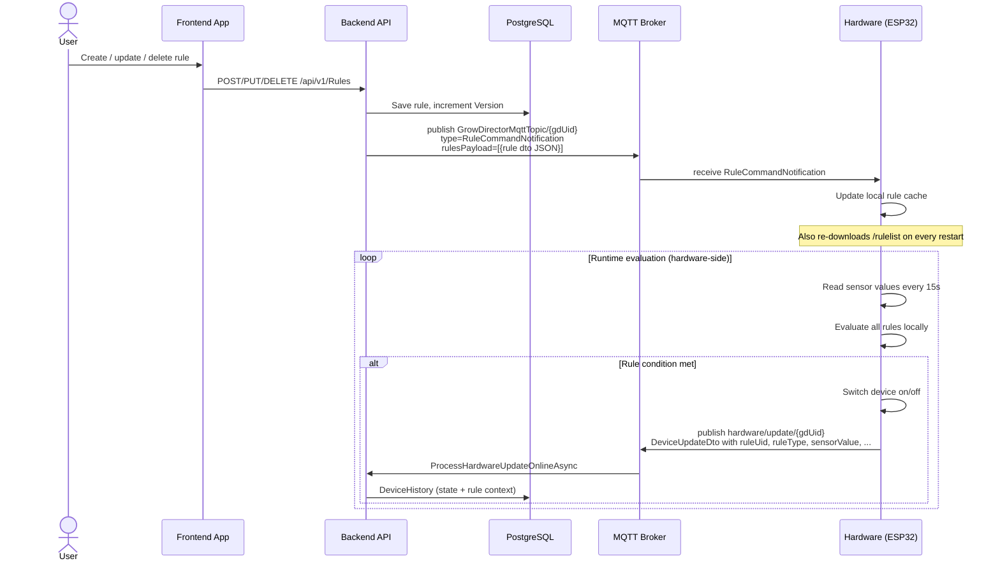

# Rules — Sensor & Schedule Automations

> Part of: [Hardware ↔ Backend Architecture](./README.md)

---

## Overview

Rules are **simple automations evaluated entirely on hardware**. The backend stores and distributes rules; hardware downloads them, monitors sensor values, and switches devices autonomously — no round-trip to the backend is needed to execute a rule.

Rule execution is reported back to the backend **implicitly** through the `hardware/update` message: the `DeviceUpdateDto` for each device carries rule context fields (`ruleUid`, `ruleType`, `sensorValue`, etc.).

---

## Rule Types

| Type | Trigger | Example use |
|------|---------|-------------|
| `Sensor` | Sensor value crosses threshold | Turn on fan when temperature > 28°C |
| `Schedule` | Time of day / day of week | Turn on lights at 06:00 for 18h |
| `PhEc` | pH or EC dosing logic | Dose nutrient when EC < 1.2 |
| `Dimmer` | Analog level control | Set dimmer to 80% when CO₂ < 800 ppm |
| `Loop` | Cyclic on/off intervals | Irrigate for 5 min every 2 hours |
| `Step` | Multi-step sequential actions | Sequential dosing steps |

All rule types share a common `BaseHwRuleDto` base with `Uid`, `Version`, `DeviceUid`, `Mode`.

---

## Lifecycle



---

## How Hardware Gets Rules

### Initial download (startup / restart)

On every boot and restart, hardware polls:

```
GET /api/v1/Hardware/rulelist?token=X&grow_director_uid=Y
```

Returns a list of `BaseHwRuleDto` (polymorphic array — each item is one of the rule type DTOs above).

### Live update (MQTT notification)

When a rule is created, modified, or deleted, the backend immediately pushes a `RuleCommandNotification`:

**Topic:** `GrowDirectorMqttTopic/{growDirectorUid}`

```json
{
  "growDirectorUid": "string",
  "type": "RuleCommandNotification",
  "ruleUid": "string",
  "rulesPayload": "[{serialized rule DTO}]"
}
```

Hardware applies the update to its local rule set without a restart.

---

## How Rule Execution Reaches the Backend

Rules are evaluated on hardware. There is **no dedicated "rule fired" event**. The backend learns about rule execution through `DeviceUpdateDto` fields in the regular `hardware/update` message:

| `DeviceUpdateDto` field | What it tells the backend |
|------------------------|--------------------------|
| `isAuto = true` | Device is currently controlled by a rule |
| `ruleUid` | Which rule is controlling it |
| `ruleType` | Type of rule (`Sensor`, `Schedule`, etc.) |
| `ruleVersion` | Version of the rule (for staleness detection) |
| `sensorUid` | Which sensor triggered the rule |
| `sensorValue` | Sensor reading at the time of activation |
| `sensorValueLow/High` | Rule thresholds |
| `switchedAt` | When the device changed state |
| `secondsToSwitchBack` | Countdown until auto-off |
| `ruleSensorStartAt/StopAt` | Sensor event window |
| `ruleStopReason` | Why the rule stopped (condition cleared, manual override, etc.) |

The backend persists this as a `DeviceHistory` record — so rule-driven state changes are captured in device history with full rule context.

---

## Rule Sync State

Separately from execution, hardware also reports **rule sync state** — whether a rule has been successfully loaded and activated:

**MQTT topic:** `hardware/rules/state/{gdUid}` (bulk or single)
**HTTP alternative:** `POST /api/v1/Hardware/Rules/state`

```json
{
  "ruleUid": "string",
  "version": 3,
  "state": "Synchronized | Synchronizing | Error",
  "errorType": "string",
  "timestamp": "2026-03-27T10:00:00Z"
}
```

This is analogous to workflow `SyncState` — it tracks whether hardware has received and activated the latest rule version, not whether the rule has fired.

---

## Conflict Protection

Rules share devices with manual commands and workflows. The backend enforces mutual exclusion:

| Scenario | Enforcement |
|----------|------------|
| Enable rule when an active workflow controls the same device | `BusinessLogicException` — names the blocking workflow |
| Activate workflow when an active rule controls the same device | `ConflictException` — lists device names |
| Manual command while a rule controls the device | Allowed — manual command takes precedence, sets `isManual = true` on hardware |

See also: [Workflow system — Constraints](../workflow-system.md#7-constraints--conflict-protection), [Manual commands — Validations](../../architecture-ru/manual-device-command-flow.md).

---

## Key Files

| File | Role |
|------|------|
| `GrowDirectorWebApi/Controllers/RuleController.cs` | REST endpoints for rule CRUD |
| `GrowDirector.Application/Services/RuleApplicationServices/RuleApplicationService.cs` | Rule business logic; calls `SendRuleCommandNotificationSharedService` on change |
| `GrowDirector.Application/Shared/Services/SendRuleCommandNotificationSharedService/` | Builds and publishes `RuleCommandNotification` MQTT message |
| `GrowDirectorWebApi/Controllers/HardwareController.cs` | `GET /rulelist`, `POST /Rules/state` endpoints |
| `GrowDirector.Application/Dto/Rule/HwRuleDtos.cs` | `BaseHwRuleDto` + per-type DTOs sent to hardware |
| `GrowDirector.Application/Services/MqttServices/MqttMessageHandler.cs` | `ProcessRuleStateBulkUpdateAsync`, `ProcessRuleStateSingleUpdateAsync` |
| `GrowDirector.Application/Services/MqttServices/MqttApplicationServiceConstants.cs` | `RuleCommandNotification` constant |
