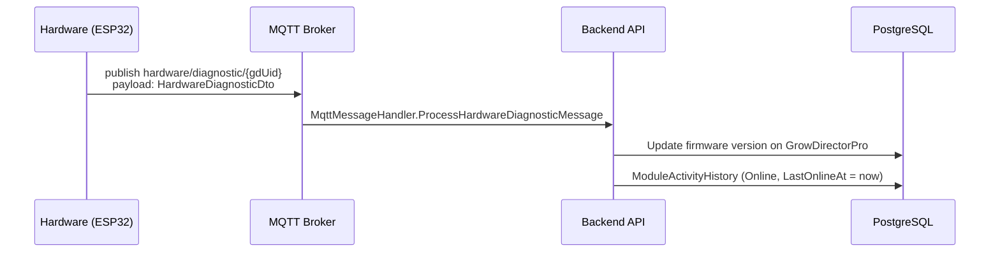
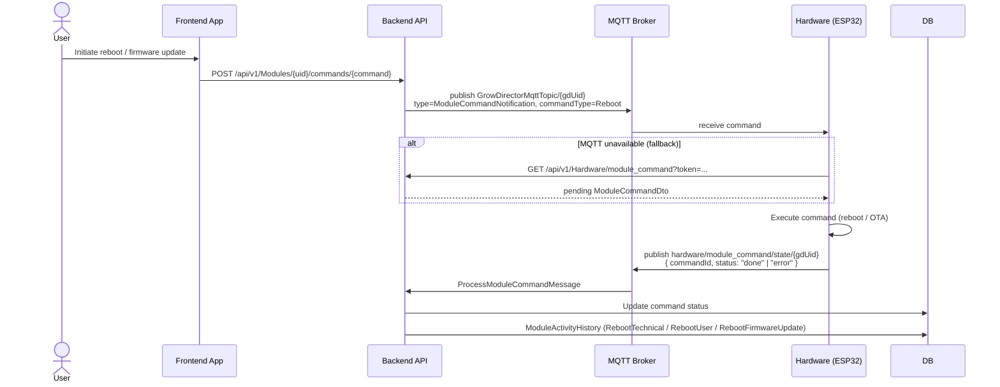

# Diagnostics & Module Commands

> Part of: [Hardware ↔ Backend Architecture](./README.md)

---

## Overview

Two related flows:

- **Diagnostics** — hardware periodically reports its internal state (firmware version, connectivity stats, error counters) to the backend.
- **Module commands** — the backend sends administrative commands to hardware (reboot, firmware OTA update). Hardware acknowledges via the same `ModuleCommandNotification` response flow.

---

## Diagnostic Reporting

Hardware pushes diagnostic data independently of sensor/device updates.

**MQTT topic:** `hardware/diagnostic/{growDirectorUid}`
**HTTP alternative:** `POST /api/v1/Hardware/diagnostic`



Diagnostic messages also serve as a **keepalive signal** — receiving one resets the module's online timer, identical to receiving a `hardware/update`.

### Firmware Version Reporting

Hardware separately reports its firmware version:

```
POST /api/v1/Hardware/firmware
```

Body: `{ "version": "1.4.2", "token": "...", "grow_director_uid": "..." }`

The backend stores this on `GrowDirectorPro.FirmwareVersion` and uses it for API availability checks (some features require minimum firmware version).

---

## Module Commands

The backend can instruct hardware to reboot or update firmware.

### Backend → Hardware (MQTT command)

**Topic:** `GrowDirectorMqttTopic/{growDirectorUid}`

```json
{
  "growDirectorUid": "string",
  "type": "ModuleCommandNotification",
  "commandType": "Reboot | FirmwareUpdate",
  "timestamp": "2026-03-27T10:00:00Z"
}
```

### Hardware → Backend (acknowledgement)

**MQTT topic:** `hardware/module_command/state/{growDirectorUid}`
**HTTP polling alternative:** `GET /api/v1/Hardware/module_command` (hardware polls for pending commands if MQTT unavailable)



### `ModuleState` values recorded

| State | Cause |
|-------|-------|
| `Online` | Any update message received |
| `Offline` | No update for 300 seconds (detected lazily) |
| `PowerOn` | Hardware boot diagnostic |
| `RebootTechnical` | Automatic / watchdog reboot |
| `RebootUser` | User-initiated reboot command |
| `FirmwareUpdate` | OTA update started |
| `RebootFirmwareUpdate` | Reboot after successful OTA |

---

## Key Files

| File | Role |
|------|------|
| `GrowDirector.Application/Services/MqttServices/MqttMessageHandler.cs` | `ProcessHardwareDiagnosticMessage`, `ProcessModuleCommandMessage` |
| `GrowDirector.Application/Services/HardwareServices/HardwareApplicationService.cs` | Diagnostic processing, firmware version update |
| `GrowDirectorWebApi/Controllers/HardwareController.cs` | `POST /firmware`, `GET /module_command`, `POST /module_command` |
| `GrowDirector.Domain/Models/ModuleActivity/ModuleActivityHistory.cs` | `ModuleState` enum, `LastOnlineAt` |
| `GD.Common.Model/Constants/CommonAppConstants.cs` | `ModuleOnlineTimeoutSeconds = 300` |
