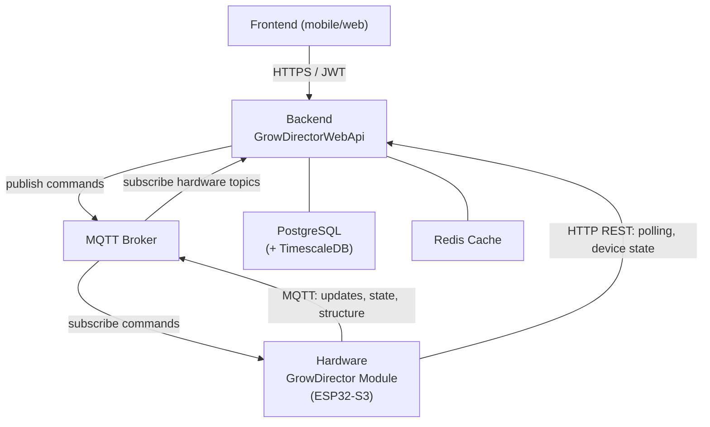

# Hardware ↔ Backend Interaction — Architecture Reference

> Source: GrowDirectorWebApi + firmware as of 2026-03-27.
> Scope: Hardware (ESP32-S3 GrowDirector modules) ↔ Backend. Frontend coverage is intentionally brief.

---

## System Overview

**Key asymmetry:**
- **Backend → Hardware**: MQTT only (device commands, rule notifications, module commands)
- **Hardware → Backend**: MQTT primary for push updates; HTTP REST for polling and device state reporting

---

## Transport: MQTT vs HTTP

### MQTT Topics (Hardware → Backend)

| Topic | Direction | Purpose |
|-------|-----------|---------|
| `hardware/structure/{gdUid}` | HW → BE | Module first-boot: register sensors and devices |
| `hardware/update/{gdUid}` | HW → BE | Periodic: sensor values + device states (every 15s sensors / event-driven devices) |
| `hardware/history/sensor/{gdUid}` | HW → BE | Catch-up: sensor readings collected while offline |
| `hardware/history/device/{gdUid}` | HW → BE | Catch-up: device state history collected while offline |
| `hardware/diagnostic/{gdUid}` | HW → BE | Firmware version, diagnostics, reboot events |
| `hardware/devices_command/state/{gdUid}` | HW → BE | Device command execution result (done/error) |
| `hardware/module_command/state/{gdUid}` | HW → BE | Module command result (reboot/update ack) |
| `hardware/rules/state/{gdUid}` | HW → BE | Rule sync state (Synchronized / Error) |

### MQTT Topics (Backend → Hardware)

| Topic | Direction | Purpose |
|-------|-----------|---------|
| `GrowDirectorMqttTopic/{gdUid}` | BE → HW | All outbound commands (device, rule, module) — differentiated by `type` field |

All outbound commands share one topic. The `type` field routes them on hardware:

| `type` value | Trigger |
|---|---|
| `DeviceCommandNotification` | Manual device on/off |
| `RuleCommandNotification` | Rule created / updated / deleted |
| `ModuleCommandNotification` | Reboot / firmware update |

### HTTP Endpoints (Hardware → Backend, polling)

Hardware polls these on startup and on-demand. No MQTT equivalent.

| Endpoint | Method | Purpose |
|----------|--------|---------|
| `GET /api/v1/Hardware/rulelist` | Polling | Download all active rules on startup or after restart |
| `GET /api/v1/Hardware/devices_command` | Polling | Fetch pending device commands (HTTP fallback) |
| `GET /api/v1/Hardware/module_command` | Polling | Fetch pending module commands (HTTP fallback) |
| `GET /api/v1/Hardware/sensor_value` | On-demand | Current sensor values (used by rule evaluation) |
| `GET /api/v1/Hardware/sensor_models` | Startup | Sensor model configuration metadata |
| `GET /api/v1/Hardware/account` | Startup | Account info for the module |
| `GET /api/v1/Hardware/is_deleted` | Startup | Check if this module has been deleted |
| `GET /api/v1/Hardware/TestConnection` | Startup | Verify backend connectivity |

### HTTP Endpoints (Hardware → Backend, push)

Hardware POSTs these as alternatives to MQTT push topics.

| Endpoint | MQTT equivalent | Purpose |
|----------|----------------|---------|
| `POST /api/v1/Hardware/structure` | `hardware/structure/{gdUid}` | Submit structure |
| `POST /api/v1/Hardware/update` | `hardware/update/{gdUid}` | Submit sensor/device update |
| `POST /api/v1/Hardware/diagnostic` | `hardware/diagnostic/{gdUid}` | Submit diagnostic info |
| `POST /api/v1/Hardware/Rules/state` | `hardware/rules/state/{gdUid}` | Rule sync state report |

> **Deduplication:** `CacheDeduplicationService` prevents double-processing when the same update arrives via both MQTT and HTTP. Key: `(MessageType, GrowDirectorUid, Timestamp)`.

---

## Key Concepts

| Term | Meaning |
|------|---------|
| **Module / Extension / GrowDirector** | The same 1:1 entity — one physical ESP32 hardware device |
| **GrowDirectorPro** | Backend DB record representing a registered module |
| **Token** | Hardware auth token — included as `?token=X&grow_director_uid=Y` on all hardware→backend HTTP calls; present in MQTT payloads too |
| **Extention** | Physical board/slot on a module; holds sensors and devices |
| **SyncState** | Backend's view of whether hardware has a config in sync (`Synchronizing → Synchronized / Error`) |

---

## Flow Index

| Flow | Document | Summary |
|------|----------|---------|
| Module initialization & onboarding | [01-module-init.md](./01-module-init.md) | First boot, token pairing, structure registration |
| Periodic hardware updates & connectivity | [02-hardware-update.md](./02-hardware-update.md) | Sensor/device updates, offline detection, offline history |
| Rules (sensor/schedule automations) | [03-rules.md](./03-rules.md) | Rule lifecycle: create → download → eval on hardware → state |
| Manual device commands | [../../architecture-ru/manual-device-command-flow.md](../../architecture-ru/manual-device-command-flow.md) _(ru)_ | User-initiated on/off commands |
| Diagnostics & module commands | [04-diagnostics.md](./04-diagnostics.md) | Reboot, firmware update, diagnostic reporting |

---

## Authentication

All hardware requests authenticate with:
- **HTTP:** `?token={hardwareToken}&grow_director_uid={uid}` query params
- **MQTT payloads:** `token` and `growDirectorUid` fields in the JSON body

The token is generated during [module onboarding](./01-module-init.md) and never changes unless manually regenerated.
