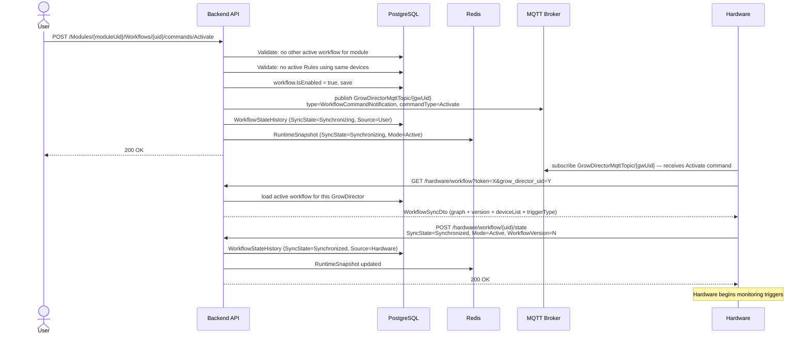
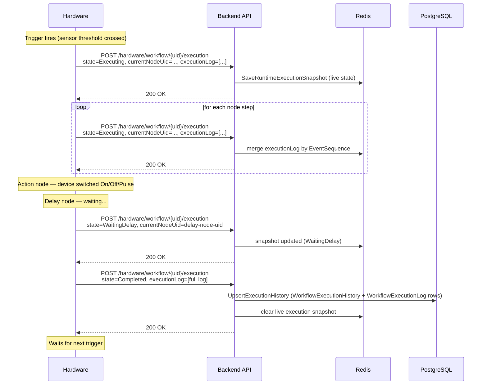

# Workflow System — Architecture Reference

> Based on source code as of 2026-03-29.
> Scope: backend ↔ hardware. Frontend coverage is intentionally brief.

---

## 1. Concepts

| Term | Meaning |
|------|---------|
| **Module / Extention / GrowDirector** | The same 1:1 entity — one physical hardware device |
| **Workflow** | A directed graph (nodes + connections) that hardware downloads and executes autonomously |
| **WorkflowVersion** | Integer, incremented on Name / Priority / Graph changes. Identifies which graph is deployed to hardware |
| **SyncState** | Backend's view of whether hardware is in sync (`Synchronizing → Synchronized / Error`) |
| **Mode** | Whether the workflow is active or inactive on hardware (`Active / Inactive`) |
| **ExecutionState** | Runtime state of a single execution run (`Executing → WaitingDelay → Completed / Error / Aborted`) |

---

## 2. Component Map

```
┌─────────────────────────────────────────────────────────────────┐
│  Frontend (brief)                                               │
│  POST /commands/{cmd}  GET /state (polling)  GET /exec_history  │
└───────────────────────────┬─────────────────────────────────────┘
                            │ HTTPS (JWT)
┌───────────────────────────▼─────────────────────────────────────┐
│  Backend — GrowDirectorWebApi                                   │
│                                                                 │
│  WorkflowsController          HardwareController                │
│        │                            │                           │
│  WorkflowApplicationService   WorkflowHardwareSyncAppService    │
│        │    (distributed lock)      │                           │
│  WorkflowDomainService        WorkflowExecutionReadSharedService │
│        │                            │                           │
│     PostgreSQL              Redis (runtime snapshot cache)      │
│                                                                 │
│  MqttApplicationService ◄──► MqttBackgroundService             │
└────────┬──────────────────────────┬─┬──────────────────────────┘
         │ MQTT publish             │ │ MQTT subscribe
         │ (commands)               │ │ hardware/workflow/state/#
         │                          │ │ hardware/workflow/execution/#
         │                          │ │ HTTP REST (state + execution)
┌────────▼──────────────────────────▼─▼──────────────────────────┐
│  Hardware (GrowDirector device)                                 │
│                                                                 │
│  Subscribes to MQTT topic for commands                          │
│  Polls  GET /hardware/workflow        (config download)         │
│  Posts  POST /hardware/workflow/{uid}/state   (sync ack)        │
│  Posts  POST /hardware/workflow/{uid}/execution  (run progress) │
│  OR publishes to MQTT topics above (same payloads)              │
└─────────────────────────────────────────────────────────────────┘
```

**Communication:** Backend→Hardware is MQTT only. Hardware→Backend supports both HTTP REST (primary) and MQTT (secondary path, same payloads). `MqttMessageHandler` handles `hardware/workflow/state/{growDirectorUid}/{workflowUid}` and `hardware/workflow/execution/{growDirectorUid}` topics, delegating to the same application service methods as `HardwareController`.

---

## 3. Data & Control Flow

### 3.1 Sequence: Activation & Hardware Sync



### 3.2 Sequence: Execution Lifecycle (Sensor Trigger Example)



---

## 4. Hardware ↔ Backend Interface

### 4.1 Backend → Hardware (MQTT, outbound)

**Topic:** `GrowDirectorMqttTopic/{growDirectorUid}`

**Workflow command payload:**

```json
{
  "growDirectorUid": "string",
  "type": "WorkflowCommandNotification",
  "commandType": "Activate | Deactivate | Resume | Abort",
  "workflowUid": "string",
  "workflowVersion": 3,
  "parameters": null,
  "timestamp": "2026-03-26T10:00:00Z"
}
```

| `commandType` | Sent when | Implemented |
|---------------|-----------|-------------|
| `Activate` | User activates or updates an active workflow | ✅ |
| `Deactivate` | User deactivates a workflow | ✅ |
| `Resume` | Resume a paused execution | ✅ |
| `Abort` | Abort a running execution | ✅ |

---

### 4.2 Hardware → Backend (HTTP REST, inbound)

Authentication: `?token={hardwareToken}&grow_director_uid={uid}` on all endpoints.

#### Download active workflow

```
GET /api/v1/hardware/workflow
```

Response — `WorkflowSyncDto`:

```json
{
  "uid": "string",
  "workflowVersion": 3,
  "name": "string",
  "moduleUid": "string",
  "priority": 1,
  "nodeCount": 5,
  "maxExecutionSteps": 100,
  "triggerType": "Sensor | Schedule | Manual",
  "deviceList": ["deviceUid1", "deviceUid2"],
  "graph": { ... }
}
```

Returns `null` body when no active workflow exists.

---

#### Report workflow state

```
POST /api/v1/hardware/workflow/{uid}/state
```

Body: single `WorkflowStateSingleDto` (same fields as array element above).

**Responses:**
- `200 OK` — accepted
- `200 OK "None"` — duplicate (cache deduplication)
- `409 Conflict { "message": "Version mismatch", "currentVersion": N }` — hardware sent stale version

---

#### Report execution progress

```
POST /api/v1/hardware/workflow/{uid}/execution
```

Body — `WorkflowExecutionUpdateDto`:

```json
{
  "workflowUid": "string",
  "workflowVersion": 3,
  "executionStartedAt": "2026-03-26T10:00:00Z",
  "timestamp": "2026-03-26T10:00:05Z",
  "accountUid": "string",
  "currentNodeUid": "node-uid",
  "executionState": "Executing | WaitingDelay | Completed | Error | Aborted",
  "errorType": "optional string",
  "errorMessage": "optional string",
  "executionLog": [
    {
      "eventSequence": 1,
      "nodeUid": "string",
      "nodeType": "Trigger | Condition | Action | Delay | Loop",
      "executedAt": "2026-03-26T10:00:01Z",
      "result": "string",
      "duration": 120,
      "context": {}
    }
  ]
}
```

**Responses:**
- `200 OK` — accepted
- `400 Bad Request` — invalid payload
- `409 Conflict { "currentVersion": N }` — version mismatch

**Backend behavior by `executionState`:**

| State | Action |
|-------|--------|
| `Executing` | Save/merge snapshot to Redis cache |
| `WaitingDelay` | Save/merge snapshot to Redis cache |
| `Completed` | Persist to DB (`WorkflowExecutionHistory` + logs), clear cache |
| `Error` | Persist to DB with errorMessage, clear cache |
| `Aborted` | Persist to DB, clear cache |

---

## 5. Workflow Graph Model

```
WorkflowGraph
├── Nodes: WorkflowNode[]
│   ├── Uid, Type (Trigger|Condition|Action|Delay|Loop)
│   ├── TriggerConfig?
│   │   ├── SensorUids[], Operator, Value / ValueLow+ValueHigh
│   │   ├── DelaySeconds
│   │   └── ScheduleConfig? { StartTime (HH:mm), EndTime, DaysOfWeek[], DaysOfMonth[] }
│   ├── ConditionConfig?
│   │   ├── LogicOperator (AND|OR)
│   │   └── Items[]: { SensorUids[], Operator, Value / ValueLow+ValueHigh }
│   ├── ActionConfig?
│   │   ├── DeviceUid, ActionType (On|Off|Pulse)
│   │   └── PulseConfig? { OnDuration, OffDuration, Cycles }
│   ├── DelayConfig?  { DelaySeconds }
│   └── LoopConfig?  { LoopType (Count|UntilCondition), MaxIterations, Condition? }
└── Connections: WorkflowConnection[]
    └── FromNodeUid, ToNodeUid, Type (Default|OnTrue|OnFalse|OnComplete|OnError)
```

**Graph validation rules (enforced on create/activate):**

- Max 20 nodes per workflow
- Exactly 1 Trigger node; no incoming connections to Trigger
- All nodes reachable from Trigger (no orphans)
- No cycles except loop-back from Loop nodes
- Condition: exactly one `OnTrue` + one `OnFalse` outgoing connection
- Action/Delay: at most one `Default`/`OnComplete` + one `OnError` forward connection
- Loop: must have exit path (`OnFalse` or `OnComplete`)
- Max 100 loop iterations (`MaxExecutionSteps = 100` in `WorkflowSyncDto`)

---

## 6. State Machines

### Sync State

```
[User activates]
      │
      ▼
 Synchronizing  ──► Synchronized
      │                  │
      └──► Error ◄───────┘  (hardware reports error, or stale version rejected)
```

Transitions recorded in `WorkflowStateHistory` with `Source` (User | Hardware) and `Reason` string.

**Known reasons:** `workflow_activated`, `workflow_updated`, `workflow_deactivated`,
`activation_ack`, `deactivation_ack`, `sync_ok`, `sync_failed`, `stale_version`.

### Version mismatch

When hardware posts state/execution with an old `WorkflowVersion`:
1. Backend returns `409 Conflict { currentVersion: N }`
2. Records `WorkflowStateHistory` with `Reason = stale_version`, `IsVersionMismatch = true`
3. Hardware is expected to re-download via `GET /hardware/workflow`

---

## 7. Constraints & Conflict Protection

### One active workflow per module

Enforced via distributed Redis lock (`WorkflowUpdate_{moduleUid}`).
Attempting to activate a second workflow throws `ConflictException`.

### Mutual exclusion with Rules (fully bidirectional)

| Operation | Check | Enforcement |
|-----------|-------|-------------|
| Activate workflow | Any active Rule (`RuleMode.On`) controls a device in `workflow.RelatedDeviceUids` | `ConflictException` — lists device names |
| Enable Rule (`Mode=On`) | Any active workflow (`IsEnabled`) controls the same device | `BusinessLogicException` — names the blocking workflow |

Neither side auto-disables the other; the user must manually deactivate the conflicting entity first.

---

## 8. Frontend Integration (brief)

| Purpose | Endpoint |
|---------|----------|
| List workflows | `GET /api/v1/Modules/{moduleUid}/Workflows` |
| Create | `POST /api/v1/Modules/{moduleUid}/Workflows` |
| Update | `PUT /api/v1/Modules/{moduleUid}/Workflows/{uid}` |
| Activate / Deactivate / Resume / Abort | `POST …/{uid}/commands/{command}` — `command` ∈ `Activate \| Deactivate \| Resume \| Abort` |
| Current state (poll) | `GET …/{uid}/state` |
| Execution history | `GET …/{uid}/execution_history?startDate&endDate&limit` (default 50, max 200) |
| State change history | `GET …/{uid}/state_history?startDate&endDate&limit` |

Live execution tracking is via **polling** `GET …/{uid}/state`. No WebSocket / SignalR / SSE.

---

## 9. Not Yet Implemented (Planned)

| Feature | Status | Notes |
|---------|--------|-------|
| Manual trigger execution | Trigger type resolved as `"Manual"` and included in `WorkflowSyncDto` | No dedicated API endpoint to fire a manual trigger run; hardware-side behavior undefined |
