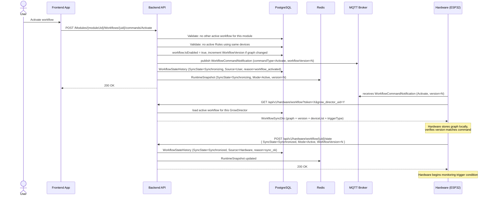
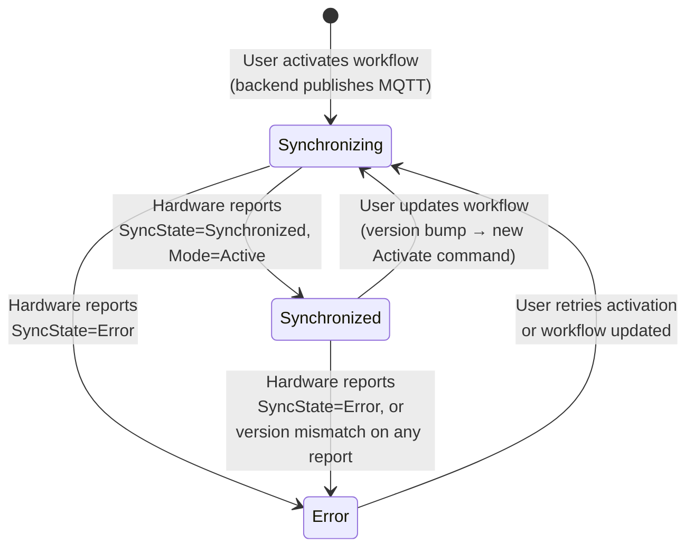
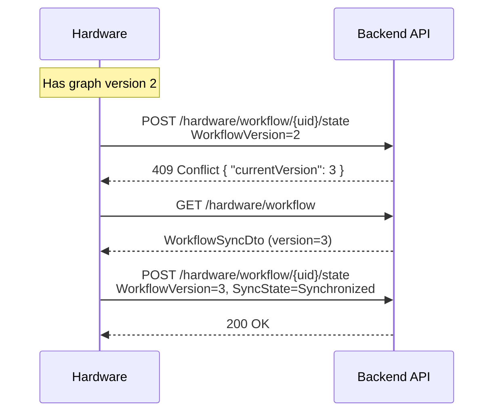
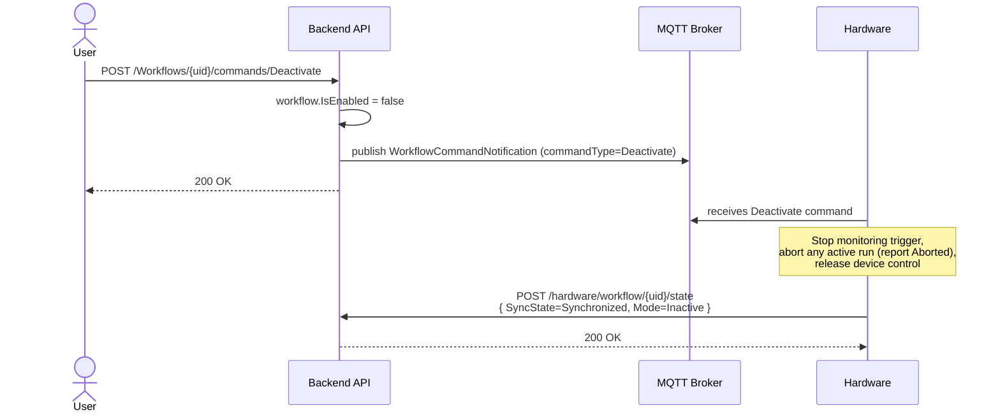
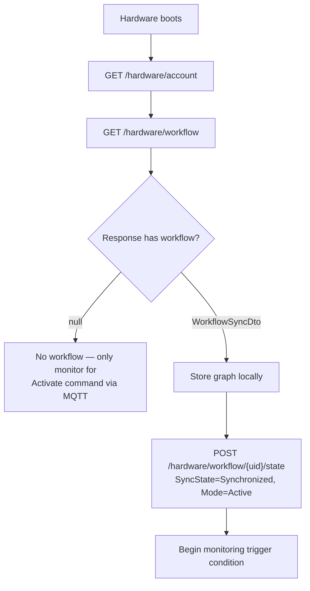

# Workflow Sync — Configuration Download & State Reporting

> Part of: [Workflow System](./README.md)

---

## Overview

Before hardware can execute a workflow it must download the current graph from the backend and acknowledge that it received it. This download+ack cycle is called **sync**. The backend tracks sync state per workflow in both PostgreSQL (`WorkflowStateHistory`) and Redis (live `WorkflowSyncRuntimeSnapshot`).

Hardware is responsible for:
1. Downloading the workflow graph when commanded.
2. Reporting back that it successfully loaded (or failed to load) the graph.
3. Re-downloading when the backend signals a version change.
4. Re-downloading on restart if a workflow was previously active.

---

## Sequence: Activation



---

## Workflow Config Download Payload

`GET /api/v1/hardware/workflow` — returns `WorkflowSyncDto`:

```json
{
  "uid": "string",
  "workflowVersion": 3,
  "name": "string",
  "moduleUid": "string",
  "priority": 1,
  "nodeCount": 5,
  "maxExecutionSteps": 100,
  "triggerType": "Sensor | Schedule | Manual",
  "deviceList": ["deviceUid1", "deviceUid2"],
  "graph": {
    "nodes": [ /* WorkflowNode[] — see 02-execution.md */ ],
    "connections": [ /* WorkflowConnection[] — see 02-execution.md */ ]
  }
}
```

| Field | Notes |
|-------|-------|
| `workflowVersion` | Hardware must store this and include it in all state and execution reports |
| `triggerType` | Pre-resolved from the Trigger node config. Informational — hardware should use the actual node config for evaluation logic |
| `deviceList` | UIDs of all devices this workflow may control. Used for conflict checks (backend-side only) |
| `maxExecutionSteps` | Currently always `100`. Hard limit on total execution steps per run |
| `nodeCount` | Number of nodes in the graph |
| `graph` | Full graph — see [02-execution.md](./02-execution.md) for the complete node/connection model |

**When no active workflow exists**, the endpoint returns HTTP 200 with a `null` body (or empty response). Hardware should treat this as "no workflow to execute."

---

## State Report Payload

`POST /api/v1/hardware/workflow/{uid}/state` — body: `WorkflowStateSingleDto`:

```json
{
  "uid": "string",
  "workflowVersion": 3,
  "syncState": "Synchronizing | Synchronized | Error",
  "mode": "Active | Inactive",
  "modeReason": "optional string",
  "errorType": "optional string",
  "timestamp": "2026-03-26T10:00:00Z",
  "accountUid": "string"
}
```

| Field | Notes |
|-------|-------|
| `uid` | Must match the `{uid}` route parameter; backend rejects mismatches |
| `workflowVersion` | Must match the currently active version. If not, backend returns `409 Conflict` — see Version Mismatch below |
| `syncState` | `Synchronizing` → hardware received command but is still loading; `Synchronized` → graph loaded and active; `Error` → failed to load |
| `mode` | `Active` if the workflow is running on hardware; `Inactive` if deactivated |
| `modeReason` | Optional free-text reason. Backend stores as-is in state history if non-empty |
| `errorType` | Short error code if `syncState=Error` (e.g., `"parse_error"`, `"memory_error"`) |
| `timestamp` | UTC timestamp of the state change. If omitted/zero, backend uses server time |
| `accountUid` | Account that owns this module. Available from `GET /hardware/account` |

### Backend responses

| HTTP | Meaning |
|------|---------|
| `200 OK` | State accepted and recorded |
| `200 OK "None"` | Duplicate — cache deduplication already processed this exact update |
| `409 Conflict { "message": "Version mismatch", "currentVersion": N }` | Hardware sent a stale `workflowVersion` — hardware must re-download |

---

## Sync State Machine



**State history reasons** (recorded in `WorkflowStateHistory.Reason`):

| Reason | Triggered by |
|--------|-------------|
| `workflow_activated` | User activates |
| `workflow_updated` | User updates an active workflow (version bump) |
| `workflow_deactivated` | User deactivates |
| `activation_ack` | Hardware reports `Synchronizing + Active` |
| `deactivation_ack` | Hardware reports `Synchronizing + Inactive` |
| `sync_ok` | Hardware reports `Synchronized` |
| `sync_failed` | Hardware reports `Error` |
| `stale_version` | Hardware sent a stale `workflowVersion` |

---

## Version Mismatch

When the user updates a workflow (name, priority, or graph), the backend increments `WorkflowVersion` and sends a new `Activate` command. If hardware sends a state or execution report with an older version:

1. Backend records `WorkflowStateHistory` with `Reason = stale_version`, `IsVersionMismatch = true`.
2. Backend returns `409 Conflict { "currentVersion": N }`.
3. **Hardware must discard its stale graph and re-download** via `GET /hardware/workflow`.

Hardware should detect this immediately and not continue executing the stale graph.



---

## Deactivation Sequence



After deactivation, `GET /hardware/workflow` returns `null`. Hardware must not attempt execution.

---

## Behavior on Hardware Restart

On every boot, hardware must check whether a workflow was previously active:



Hardware should NOT resume an in-progress run from before the restart. Any previously-running execution is considered lost. If the previous run was never terminated, hardware should report its final state as `Aborted` before reporting the new `Synchronized` state — or simply not report it (backend will treat the run as lost; it was never persisted to DB since it never reached a terminal state while hardware was up).

---

## Key Backend Files

| File | Role |
|------|------|
| `GrowDirectorWebApi/Controllers/HardwareController.cs` | `GET /workflow`, `POST /workflow/{uid}/state`, `POST /workflow/{uid}/execution` endpoints |
| `GrowDirector.Application/Services/WorkflowService/WorkflowHardwareSyncApplicationService.cs` | All hardware sync + execution logic |
| `GrowDirector.Application/Dto/Hardware/WorkflowStateDto.cs` | `WorkflowStateSingleDto` payload |
| `GrowDirector.Application/Dto/Workflow/WorkflowSyncDto.cs` | Download response DTO |
| `GrowDirector.Application/Services/MqttServices/MqttMessageHandler.cs` | MQTT alt-path for state and execution |
| `GrowDirector.Domain/Models/Workflows/WorkflowRuntimeEnums.cs` | `WorkflowSyncState`, `WorkflowMode`, `WorkflowExecutionState` |
