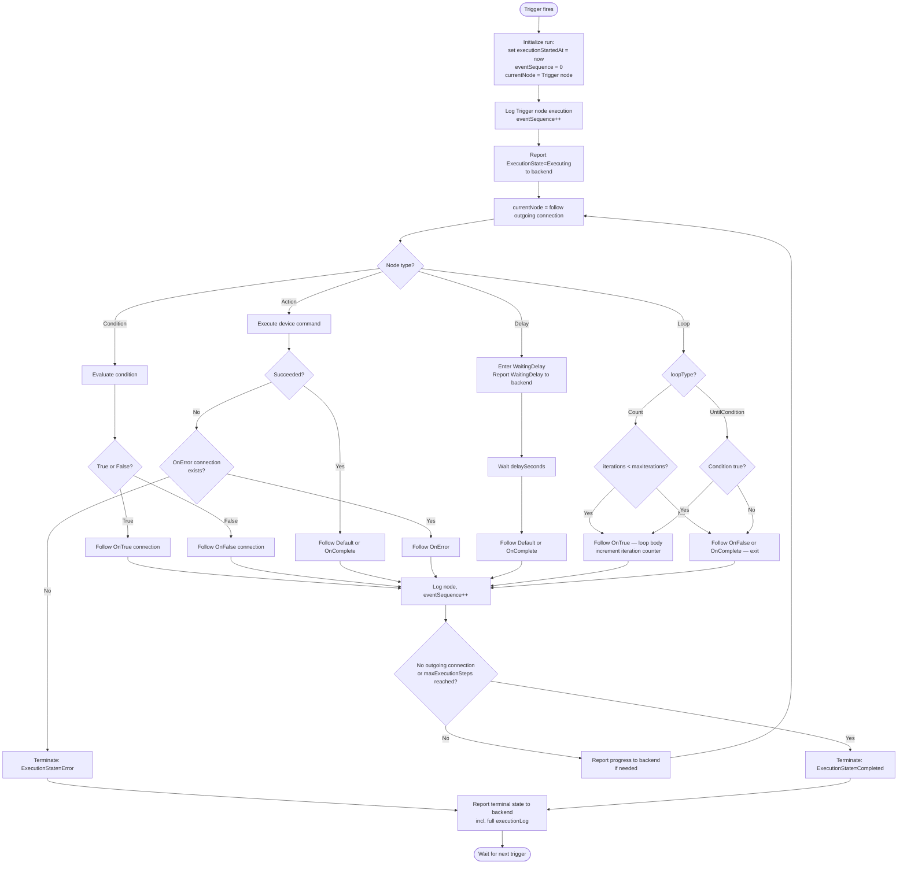
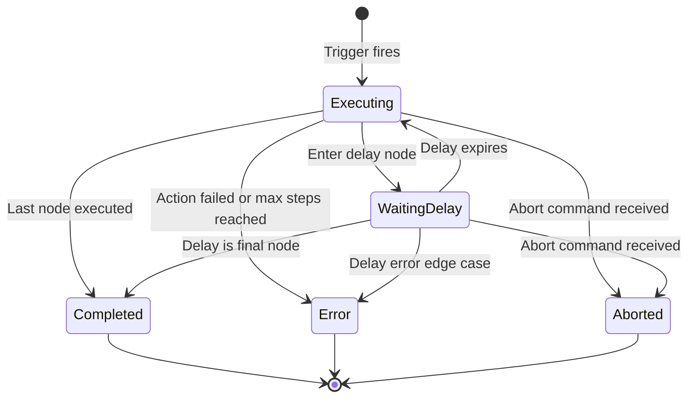
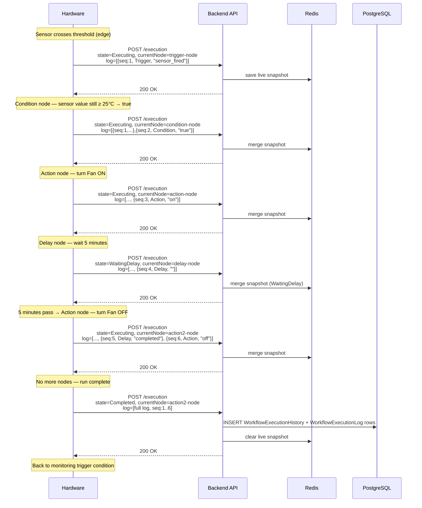

# Workflow Execution — Graph Traversal & Node Semantics

> Part of: [Workflow System](./README.md)

---

## Overview

After hardware has downloaded and synced a workflow (see [01-sync.md](./01-sync.md)), it becomes the sole execution engine. Hardware:

1. **Monitors** the trigger condition continuously.
2. **Fires** a run when the trigger condition is met.
3. **Traverses** the graph node by node, executing each node's action.
4. **Reports** progress to the backend after each node (or in batches).
5. **Terminates** the run in one of: `Completed`, `Error`, or `Aborted`.

The backend never issues "next step" commands — it only observes. Backend → Hardware execution commands are limited to `Resume` and `Abort`.

---

## Graph Model

### Node

```json
{
  "uid": "string",
  "type": "Trigger | Condition | Action | Delay | Loop",
  "name": "string",
  "position": { "x": 100, "y": 200 },
  "triggerConfig": { ... },
  "conditionConfig": { ... },
  "actionConfig": { ... },
  "delayConfig": { ... },
  "loopConfig": { ... }
}
```

Exactly one config object is non-null, matching the node `type`. `position` is used by the visual editor only; hardware ignores it.

### Connection

```json
{
  "uid": "string",
  "fromNodeUid": "string",
  "toNodeUid": "string",
  "type": "Default | OnTrue | OnFalse | OnComplete | OnError",
  "label": "optional string"
}
```

### Connection semantics

| `type` | Used by node types | Meaning |
|--------|--------------------|---------|
| `Default` | Trigger, Action, Delay | Normal forward path |
| `OnTrue` | Condition, Loop | Condition is true / loop continues |
| `OnFalse` | Condition, Loop | Condition is false / loop exits |
| `OnComplete` | Action, Delay, Loop | Successful completion path (alternative to Default) |
| `OnError` | Action, Delay | Error/failure path |

`Default` and `OnComplete` are mutually exclusive forward paths — a node has at most one of the two.

### Graph constraints (validated by backend on create/activate)

| Rule | Details |
|------|---------|
| Max 20 nodes per workflow | |
| Exactly 1 Trigger node | Trigger has no incoming connections |
| All nodes reachable from Trigger | No orphans allowed |
| No cycles except loop-back | Only `Loop → OnTrue` connections may form cycles |
| Condition: exactly `OnTrue` + `OnFalse` | No other outgoing connections |
| Action/Delay: at most one forward + one `OnError` | Forward = `Default` or `OnComplete` (not both) |
| Loop: must have exit path | At least one `OnFalse` or `OnComplete` outgoing connection |
| Loop `Count`: `MaxIterations` ∈ [1, 100] | |
| Loop `UntilCondition`: must have `Condition` config | |

Hardware receives only validated graphs; these constraints will always hold.

---

## Node Semantics

### Trigger Node

The entry point of the graph. Hardware evaluates trigger conditions continuously while the workflow is `Active`. A trigger fires when its condition transitions from not-met to met (edge-based, not level-based).

#### Sensor Trigger

`TriggerConfig` with `sensorUids`, `operator`, `value`/`valueLow`/`valueHigh`, and optional `delaySeconds`:

```json
{
  "sensorUids": ["sensor-uid-1"],
  "operator": "GreaterThan | LessThan | Equals | NotEquals | Between | NotBetween",
  "value": 28.0,
  "valueLow": null,
  "valueHigh": null,
  "delaySeconds": 60
}
```

**Evaluation logic:**

| Operator | Fires when |
|----------|-----------|
| `GreaterThan` | latest sensor value > `value` |
| `LessThan` | latest sensor value < `value` |
| `Equals` | latest sensor value == `value` |
| `NotEquals` | latest sensor value != `value` |
| `Between` | `valueLow` ≤ latest value ≤ `valueHigh` |
| `NotBetween` | latest value < `valueLow` OR > `valueHigh` |

When multiple `sensorUids` are listed, the trigger fires if **any** sensor meets the condition (OR semantics at the trigger level).

**Edge detection:** The trigger fires only on the rising edge — i.e., condition changes from false to true. If the condition is already true at the moment of workflow activation, hardware must wait for it to become false and then true again before firing.

**`delaySeconds`:** If specified, the condition must remain true for `delaySeconds` before the trigger fires. If the condition becomes false before the delay expires, the timer resets.

**During active run:** Sensor triggers are ignored — skip until the current run reaches a terminal state.

#### Schedule Trigger

`TriggerConfig` with `schedule`:

```json
{
  "schedule": {
    "startTime": "06:00",
    "endTime": "22:00",
    "daysOfWeek": [1, 2, 3, 4, 5],
    "daysOfMonth": []
  }
}
```

- `startTime` / `endTime`: 24-hour `HH:mm` format in the module's local timezone.
- `daysOfWeek`: 1=Monday … 7=Sunday. If empty, applies every day.
- `daysOfMonth`: Calendar days 1–31. If both `daysOfWeek` and `daysOfMonth` are non-empty, the day must match **either** list.
- **Fires at `startTime`** on each matching day. If the module is offline at `startTime`, the trigger does **not** fire retroactively on reconnect.
- **`endTime`** is informational (defines the window); the trigger fires once at `startTime`, not continuously throughout the window.
- **During active run:** Schedule trigger at the next `startTime` is skipped.

#### Manual Trigger

`TriggerConfig` is null or has no `sensorUids` and no `schedule`. The `triggerType` field in `WorkflowSyncDto` will be `"Manual"`.

**Not yet implemented.** See [Manual Trigger Spec](#manual-trigger-spec) below.

---

### Condition Node

Evaluates a set of sensor conditions and branches to `OnTrue` or `OnFalse`.

```json
{
  "conditionConfig": {
    "logicOperator": "AND | OR",
    "conditions": [
      {
        "sensorUids": ["sensor-uid"],
        "operator": "GreaterThan",
        "value": 25.0,
        "valueLow": null,
        "valueHigh": null
      }
    ]
  }
}
```

- Each `ConditionItem` evaluates to true/false the same way as Sensor Trigger operators above.
- When multiple `sensorUids` are listed in one item: the item is true if **any** sensor meets the condition.
- Multiple items are combined with `AND` / `OR` as specified by `logicOperator`.
- If the condition is true → follow `OnTrue` connection.
- If the condition is false → follow `OnFalse` connection.
- Condition evaluation is instantaneous; hardware reads the latest available sensor value.
- No error path — always results in true or false.

---

### Action Node

Controls a device and waits for the action to complete.

```json
{
  "actionConfig": {
    "deviceUid": "device-uid",
    "actionType": "On | Off | Pulse",
    "duration": null,
    "pulseConfig": {
      "onDuration": 30,
      "offDuration": 10,
      "cycles": 3
    }
  }
}
```

| `actionType` | Behavior |
|-------------|----------|
| `On` | Switch device on. Node completes when device confirms the `on` state |
| `Off` | Switch device off. Node completes when device confirms the `off` state |
| `Pulse` | Cycle: turn On for `onDuration` seconds, Off for `offDuration` seconds, repeat `cycles` times. Node completes when all cycles finish |

- **Completion:** Follow `Default` or `OnComplete` connection (whichever is present).
- **Failure:** If the device cannot be controlled (e.g., command rejected, hardware fault), follow `OnError` connection if present. If no `OnError` connection exists, the entire run terminates with `ExecutionState = Error`.
- `duration` field is optional and currently unused (reserved for future use).

---

### Delay Node

Pauses execution for a fixed duration.

```json
{
  "delayConfig": {
    "delaySeconds": 300
  }
}
```

- Hardware enters `WaitingDelay` state for `delaySeconds`.
- During this time hardware should report `ExecutionState = WaitingDelay` to the backend (so the UI shows the pause).
- After the delay expires → follow `Default` or `OnComplete` connection.
- If `Abort` command arrives during a delay → terminate immediately with `Aborted`.
- If `Resume` command arrives during a delay that was externally paused → resume the countdown.

---

### Loop Node

Repeats a subgraph body a bounded number of times.

```json
{
  "loopConfig": {
    "loopType": "Count | UntilCondition",
    "maxIterations": 5,
    "condition": {
      "sensorUids": ["sensor-uid"],
      "operator": "GreaterThan",
      "value": 25.0
    }
  }
}
```

#### Loop Type: `Count`

- Execute the loop body (`OnTrue` path) `maxIterations` times (max 100).
- After all iterations complete → follow `OnFalse` or `OnComplete` (exit path).
- Hardware must track the iteration counter.

#### Loop Type: `UntilCondition`

- Evaluate `condition` (same semantics as one `ConditionItem` in a Condition node).
- If condition is **true** → execute loop body (`OnTrue` path), then re-evaluate.
- If condition is **false** → exit loop (`OnFalse` or `OnComplete` path).
- Always check condition **before** each iteration (pre-condition loop).
- The `maxExecutionSteps` field in `WorkflowSyncDto` (currently always `100`) is the absolute safety cap on total execution steps across the entire run, not just loop iterations.

**Loop-back connections:** The `OnTrue` edge from a Loop node points back to a node earlier in the graph. This is the only allowed cycle in the graph. Hardware should implement iteration counting to prevent infinite loops even for `UntilCondition` type (respect `maxExecutionSteps`).

---

## Graph Traversal Algorithm



---

## Execution Lifecycle State Machine



Terminal states: `Completed`, `Error`, `Aborted`. When reached, hardware persists the run to DB via the execution endpoint.

---

## One-Run-at-a-Time Rule

Only one run is allowed at a time per workflow:

| Scenario | Hardware behavior |
|----------|-------------------|
| Sensor trigger fires while run is in progress | Ignore — do not start a new run |
| Schedule time arrives while run is in progress | Ignore — skip this schedule slot |
| Manual trigger requested while run is in progress | Backend rejects with conflict; hardware receives no extra command |
| `Abort` command arrives | Terminate current run immediately with `Aborted` |

After a run reaches a terminal state, the hardware returns to monitoring the trigger condition.

---

## Execution Reporting Protocol

### When to report

Hardware must POST to `/api/v1/hardware/workflow/{uid}/execution` (or publish to the MQTT topic):

1. **On each node execution** — for observability (UI shows which node is active).
2. **On `WaitingDelay`** — so the UI shows the delay countdown.
3. **On terminal state** — `Completed`, `Error`, or `Aborted` — this triggers DB persistence.

Reporting on every single node step is the recommended approach. For bandwidth-constrained implementations, batching intermediate steps is acceptable as long as the terminal report contains the full `executionLog`.

### Execution report payload

`POST /api/v1/hardware/workflow/{uid}/execution` — body: `WorkflowExecutionUpdateDto`:

```json
{
  "workflowUid": "string",
  "workflowVersion": 3,
  "executionStartedAt": "2026-03-26T10:00:00Z",
  "timestamp": "2026-03-26T10:00:05Z",
  "accountUid": "string",
  "currentNodeUid": "node-uid",
  "executionState": "Executing | WaitingDelay | Completed | Error | Aborted",
  "errorType": "optional string",
  "errorMessage": "optional string",
  "executionLog": [
    {
      "eventSequence": 1,
      "nodeUid": "trigger-node-uid",
      "nodeType": "Trigger",
      "executedAt": "2026-03-26T10:00:00Z",
      "result": "fired",
      "duration": 0,
      "context": {}
    }
  ]
}
```

| Field | Notes |
|-------|-------|
| `workflowVersion` | Must match current version. `409` if stale — re-download and abort run |
| `executionStartedAt` | Fixed UTC timestamp from when this run started. **Same value in all reports for this run** — it identifies the run |
| `timestamp` | UTC time of this specific report |
| `currentNodeUid` | UID of the node currently executing (or last executed) |
| `executionState` | Current state of this run |
| `errorType` | Short error code if applicable (e.g., `"device_error"`, `"timeout"`) |
| `errorMessage` | Human-readable error detail |
| `executionLog` | All events executed so far in this run — see below |

### `executionLog` entries

```json
{
  "eventSequence": 1,
  "nodeUid": "string",
  "nodeType": "Trigger | Condition | Action | Delay | Loop",
  "executedAt": "2026-03-26T10:00:01Z",
  "result": "string",
  "duration": 120,
  "context": {}
}
```

| Field | Notes |
|-------|-------|
| `eventSequence` | Monotonically increasing integer starting at 1. **Must be > 0.** Used by backend to deduplicate and merge incremental reports |
| `nodeUid` | UID of the node that executed |
| `nodeType` | Type of the node |
| `executedAt` | UTC time when this node started executing |
| `result` | Free-text outcome string. Recommended values by node type — see table below |
| `duration` | Execution time in milliseconds |
| `context` | Optional JSON object with additional node-specific data (sensor values, device state, loop counter, etc.) |

**Recommended `result` values:**

| Node type | Scenario | `result` |
|-----------|----------|---------|
| Trigger | Sensor fired | `"sensor_fired"` |
| Trigger | Schedule fired | `"schedule_fired"` |
| Condition | Condition true | `"true"` |
| Condition | Condition false | `"false"` |
| Action | Device turned on | `"on"` |
| Action | Device turned off | `"off"` |
| Action | Pulse completed | `"pulse_complete"` |
| Action | Device error | `"error"` |
| Delay | Delay completed | `"completed"` |
| Loop | Iteration started | `"iteration_N"` (e.g., `"iteration_1"`) |
| Loop | Loop exited | `"exit"` |

### ExecutionLog merge behavior

The backend merges incoming `executionLog` entries with any existing snapshot by `eventSequence`. Incremental reporting (sending only new events each time) and cumulative reporting (resending all events each time) are both supported. Deduplication is by `eventSequence` — first entry seen wins.

### Backend behavior by `executionState`

| `executionState` | Backend action |
|-----------------|----------------|
| `Executing` | Merge log into Redis live snapshot. No DB write |
| `WaitingDelay` | Merge log into Redis live snapshot. No DB write |
| `Completed` | Persist `WorkflowExecutionHistory` + all `WorkflowExecutionLog` rows to PostgreSQL. Clear Redis snapshot |
| `Error` | Persist to PostgreSQL with `errorMessage`. Clear Redis snapshot |
| `Aborted` | Persist to PostgreSQL. Clear Redis snapshot |

### HTTP responses

| HTTP | Meaning | Hardware action |
|------|---------|-----------------|
| `200 OK` | Accepted | Continue |
| `400 Bad Request` | Invalid payload (e.g., missing `executionStartedAt`, `eventSequence ≤ 0`) | Log error, do not retry same payload |
| `409 Conflict { "currentVersion": N }` | Stale `workflowVersion` | Abort run, re-download workflow |

---

## Example: Execution Sequence (Sensor Trigger → Condition → Action → Delay → Action → Completed)



---

## Resume & Abort Commands

Hardware receives these via `WorkflowCommandNotification` on `GrowDirectorMqttTopic/{uid}`.

### Abort

```json
{ "commandType": "Abort", "workflowUid": "...", "workflowVersion": N }
```

- Terminate the current run immediately, regardless of which node is executing.
- Report terminal state: `POST /execution` with `executionState=Aborted` and the accumulated `executionLog`.
- If no run is in progress, acknowledge gracefully (no-op, no error).
- Do **not** stop monitoring the trigger — the workflow remains `Active` and will fire again on the next trigger event.

### Resume

```json
{ "commandType": "Resume", "workflowUid": "...", "workflowVersion": N }
```

- Currently reserved for future use. Intended to unpause a run that was paused externally.
- Hardware should acknowledge the command without action if no run is paused.

---

## Manual Trigger Spec

> **Status: Not yet implemented.** The `triggerType = "Manual"` value is reserved and propagated in `WorkflowSyncDto`, but no dedicated run-trigger endpoint exists yet.

When a workflow has a Manual trigger (Trigger node has no `sensorUids` and no `schedule` in `TriggerConfig`):

- Hardware should **not** monitor any sensor or schedule.
- The run is initiated **exclusively** by a `Resume` command from the backend with an additional parameter (exact contract TBD, likely `{ "commandType": "Resume", "manualRun": true }`).
- On receiving this command: start a new run immediately (fire the Trigger node), then traverse the graph normally.
- If a run is already in progress when the command arrives: do not start a second run; the backend will return a conflict to the user.
- All other execution and reporting semantics are identical to sensor/schedule-triggered runs.

---

## Error Handling Summary

| Scenario | Expected hardware behavior |
|----------|---------------------------|
| Action node fails, `OnError` connection exists | Follow `OnError` path, log node with `result="error"` |
| Action node fails, no `OnError` connection | Terminate run: report `ExecutionState=Error` with `errorType` and `errorMessage` |
| `maxExecutionSteps` reached | Terminate run: report `ExecutionState=Error`, `errorMessage="max_steps_exceeded"` |
| `409` on execution report (version mismatch) | Abort current run (report `Aborted`), re-download workflow, resume normal sync |
| `Deactivate` command arrives during run | Terminate run (report `Aborted`), report sync state `Mode=Inactive`, stop monitoring trigger |
| Hardware restart during run | Run is lost. On boot: re-download workflow, report `SyncState=Synchronized`, start monitoring trigger fresh |

---

## Key Backend Files

| File | Role |
|------|------|
| `GrowDirector.Application/Dto/Hardware/WorkflowExecutionDto.cs` | `WorkflowExecutionUpdateDto`, `WorkflowExecutionLogDto` |
| `GrowDirector.Application/Services/WorkflowService/WorkflowHardwareSyncApplicationService.cs` | `SetWorkflowExecutionAsync` — merge/persist logic, log merging, version check |
| `GrowDirector.Application/Services/WorkflowService/WorkflowGraphValidator.cs` | Graph validation rules (enforced on create/activate — not at runtime) |
| `GrowDirector.Domain/Models/Workflows/WorkflowGraph.cs` | `WorkflowGraph`, `WorkflowNode`, `WorkflowConnection`, all config types |
| `GrowDirector.Domain/Models/Workflows/WorkflowEnums.cs` | `WorkflowNodeType`, `WorkflowConnectionType`, `WorkflowActionType`, etc. |
| `GrowDirector.Domain/Models/Workflows/WorkflowRuntimeEnums.cs` | `WorkflowExecutionState`, `WorkflowSyncState`, `WorkflowMode` |
