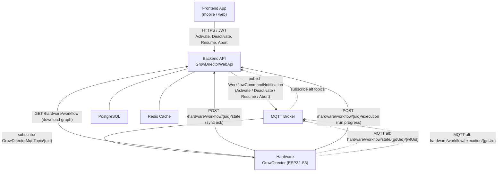

# Workflow System — Hardware Execution Reference

> Part of: [Hardware ↔ Backend Architecture](../README.md)
>
> Backend: **fully implemented** (branch `feature/GDV1-3231-wf-api`, 2026-03-29).
> Firmware: **not yet implemented** (epic GDV1-2591, ~80h estimate). This document serves as the firmware implementation specification.

---

## Overview

A **Workflow** is a directed automation graph stored in the backend and executed **autonomously on hardware**. The backend acts as configuration store and observer; the hardware is the sole runtime engine.

Compared to [Rules](../03-rules.md), workflows are significantly more expressive:

| Feature | Rules | Workflows |
|---------|-------|-----------|
| Trigger types | Sensor, Schedule | Sensor, Schedule, Manual |
| Branching logic | None | Condition nodes (AND/OR) |
| Sequential actions | None | Multiple Action/Delay nodes |
| Loops | Loop rule type only | Loop nodes with Count/UntilCondition |
| Execution reporting | Via device state in `hardware/update` | Dedicated per-step execution log |
| Backend observability | Implicit (device history) | Explicit (live Redis snapshot + DB history) |
| Conflict with active rules | Prevented | Fully bidirectional enforcement |

---

## Architecture



**Key asymmetry:**
- **Backend → Hardware:** MQTT only. One shared topic `GrowDirectorMqttTopic/{growDirectorUid}`, differentiated by `type` field.
- **Hardware → Backend (config download):** HTTP REST only. No MQTT equivalent.
- **Hardware → Backend (state + execution reporting):** HTTP REST is primary. MQTT topics exist as an alternative path with identical payloads. Backend deduplicates if both arrive.

---

## Concepts

| Term | Meaning |
|------|---------|
| **Workflow** | A directed graph (nodes + connections) that hardware downloads, monitors, and executes |
| **WorkflowVersion** | Integer, incremented on every name / priority / graph change. Hardware must track the version it currently has |
| **SyncState** | Whether hardware has successfully loaded the current version: `Synchronizing → Synchronized / Error` |
| **Mode** | Whether the workflow is logically active on this hardware unit: `Active / Inactive` |
| **ExecutionState** | Runtime state of a single execution run: `Executing → WaitingDelay → Completed / Error / Aborted` |
| **Run** | One complete execution from trigger-fire to terminal state. Identified by `(workflowUid, workflowVersion, executionStartedAt)` |
| **ExecutionLog** | Ordered list of node execution events within a run, identified by `eventSequence` |
| **TriggerType** | Resolved from the graph: `Sensor`, `Schedule`, or `Manual` |

---

## Transport Reference

### Backend → Hardware (MQTT outbound)

**Topic:** `GrowDirectorMqttTopic/{growDirectorUid}`

```json
{
  "growDirectorUid": "string",
  "type": "WorkflowCommandNotification",
  "commandType": "Activate | Deactivate | Resume | Abort",
  "workflowUid": "string",
  "workflowVersion": 3,
  "parameters": null,
  "timestamp": "2026-03-26T10:00:00Z"
}
```

| `commandType` | When sent |
|---------------|-----------|
| `Activate` | User activates a workflow, or updates an already-active workflow (version bump) |
| `Deactivate` | User deactivates the workflow |
| `Resume` | User requests resumption of a paused execution |
| `Abort` | User requests termination of a running execution |

### Hardware → Backend (HTTP, polling / push)

Authentication on all requests: `?token={hardwareToken}&grow_director_uid={uid}`

| Endpoint | When called | Purpose |
|----------|-------------|---------|
| `GET /api/v1/hardware/workflow` | On `Activate` command; on restart if workflow was active | Download active workflow graph |
| `POST /api/v1/hardware/workflow/{uid}/state` | After download, after deactivation, on error | Report sync state |
| `POST /api/v1/hardware/workflow/{uid}/execution` | Each node execution step during a run | Report execution progress |

### Hardware → Backend (MQTT, alternative path)

| Topic | Purpose |
|-------|---------|
| `hardware/workflow/state/{growDirectorUid}/{workflowUid}` | Same as POST `/state` above |
| `hardware/workflow/execution/{growDirectorUid}` | Same as POST `/execution` above |

---

## Conflict Protection

Hardware must **not** be confused by these backend-enforced constraints (they're enforced before commands reach hardware, but hardware should know about them):

| Constraint | Rule |
|------------|------|
| One active workflow per module | Only one workflow is `IsEnabled` at a time; `GET /hardware/workflow` always returns exactly one or null |
| Mutual exclusion with Rules | If a workflow is active, backend blocks new rules on the same devices; if rules are active, backend blocks workflow activation on those devices |

---

## Document Index

| Document | Content |
|----------|---------|
| [01-sync.md](./01-sync.md) | Workflow config download, state reporting, sync state machine, version mismatch, deactivation |
| [02-execution.md](./02-execution.md) | Graph traversal, node semantics, execution lifecycle, reporting protocol, Resume/Abort, Manual trigger |
